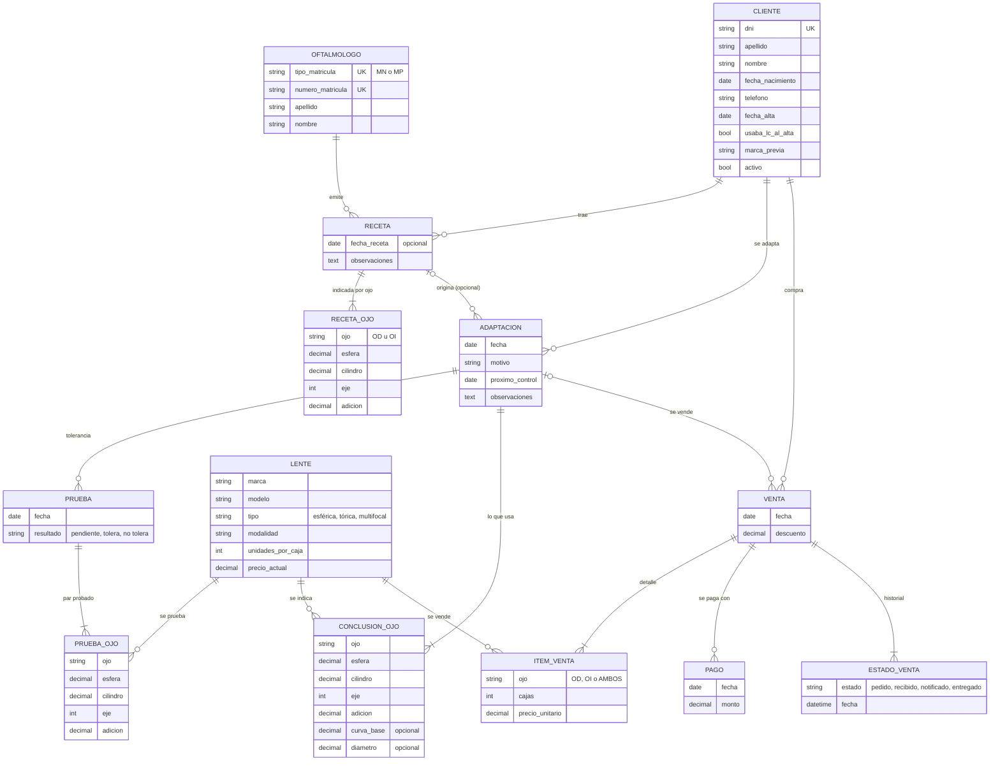

# Sistema de Gestión Óptica · Contactología

Sistema para registrar y consultar las fichas de clientes del área de contactología de una óptica. Reemplaza las fichas en papel por una base de datos con historial completo: qué recetó el oftalmólogo, qué lentes se probaron, qué terminó usando el cliente, qué compró y en qué estado está su pedido.

> **Estado:** en desarrollo · Etapa 0, relevamiento. Ver [Estado del proyecto](#estado-del-proyecto).

---

## El problema

Hoy cada cliente tiene una ficha en papel con sus datos, la graduación de la receta, los lentes de prueba, la conclusión de la adaptación, lo que compró, lo que pagó y el estado del pedido. Eso trae cuatro problemas concretos:

- **Los cambios se acumulan sin orden.** Cada recompra o cambio de graduación se agrega debajo de la anterior y las recetas nuevas se abrochan a la ficha. Reconstruir la historia de un cliente lleva tiempo.
- **Las cuentas se hacen a mano.** El saldo pendiente se calcula y se escribe en cada ficha, y un error pasa desapercibido.
- **El seguimiento de pedidos depende de revisar fichas.** Saber qué lentes llegaron y a quién falta avisar requiere recorrer el fichero.
- **No hay información agregada.** Preguntas simples, como qué oftalmólogos derivan más clientes, no tienen respuesta sin contar ficha por ficha.

## Qué hace el sistema

- **Clientes:** alta, edición, baja lógica y búsqueda por apellido, nombre o DNI. Registra si el cliente ya usaba lentes de contacto al llegar y de qué marca.
- **Oftalmólogos por matrícula:** al cargar una receta se busca al oftalmólogo por su matrícula. Si ya existe, completa nombre y apellido; si no, se da de alta en la misma pantalla. Nunca se carga dos veces el mismo profesional.
- **Receta, prueba y conclusión:** la graduación indicada por el oftalmólogo, los pares probados con su resultado y la conclusión final por ojo, con marca y tipo de lente. Si una prueba no se tolera, se registra otra con otra marca.
- **Dos caminos de alta:** quien nunca usó lentes de contacto pasa obligatoriamente por receta, prueba y conclusión. Quien ya los usa puede registrarse solo con la conclusión, para dejar constancia de lo que viene usando.
- **Actualizaciones con historial:** una nueva receta, un cambio de marca o de graduación crea una adaptación nueva. Nada se sobrescribe.
- **Ventas y pedidos:** cajas por ojo o para ambos ojos, promociones, seña y pagos parciales con saldo calculado, y seguimiento del pedido (pedido, recibido, notificado, entregado) con la fecha de cada paso.
- **Panel de pendientes:** lentes recibidas sin avisar, avisadas sin retirar y ventas con saldo.

## Reglas de negocio

1. **Receta, prueba y conclusión son datos distintos.** La receta es lo indicado; la conclusión, lo que el cliente usa. Pueden diferir porque la lente no se fabrica en ese valor (por ejemplo, ejes de a 10°) o para igualar la graduación de ambos ojos.
2. **La prueba de tolerancia es obligatoria solo para quien nunca usó lentes de contacto.**
3. **Un oftalmólogo se identifica por tipo y número de matrícula** (MN o MP). La combinación es única en la base.
4. **Nada se pisa.** Adaptaciones, pagos y estados del pedido se acumulan como historial.
5. **El total y el saldo se calculan.** Total: cajas por precio de cada ítem, menos descuento. Saldo: total menos pagos.
6. **Los clientes no se borran.** La baja es lógica para conservar el historial.

## Modelo de datos



## Stack

| Capa | Tecnología |
|---|---|
| Lenguaje | Python 3.12+ |
| Framework | Django 6 |
| Base de datos | PostgreSQL |
| Interfaz | Django Templates, Bootstrap 5, django-crispy-forms, JavaScript sin frameworks |
| Servidor local | waitress |
| Configuración | python-dotenv |
| Control de versiones | Git y GitHub |

## Decisiones técnicas

| Decisión | Por qué |
|---|---|
| Django en lugar de Flask | El admin, las migraciones y la autenticación vienen incluidos. Permite concentrar el tiempo en el dominio y no en la infraestructura. |
| Aplicación web que corre en local | Funciona sin internet y sin costo mensual. En la óptica se abre en una ventana propia, sin navegador visible, y otras PCs de la red local pueden usarla sin instalar nada. |
| PostgreSQL desde el inicio | Maneja bien varios usuarios simultáneos en la red local y es la misma base del despliegue de demostración. |
| Graduación en una fila por ojo | Normaliza los datos: no hay columnas duplicadas `od_` / `oi_`, y cada ojo puede llevar una lente distinta. |
| Modelo abstracto `GraduacionOjo` | Receta, prueba y conclusión comparten campos sin repetir código ni mezclar tablas. |
| Prueba y conclusión separadas | Una adaptación puede tener varias pruebas, pero una sola conclusión por ojo. Quien ya usa lentes puede tener conclusión sin prueba. |
| Receta opcional en la adaptación | Permite registrar a quien ya usa lentes sin inventar datos que no trae. |
| Matrícula única por tipo y número | El mismo número puede existir como matrícula nacional y provincial. La restricción vive en la base, no solo en el formulario. |
| Estados del pedido como historial | Se sabe cuándo se pidió, recibió, avisó y entregó cada pedido, no solo el último estado. |
| Total y saldo calculados | Nunca se guardan: se derivan de ítems y pagos. En el relevamiento, la mayoría de los saldos escritos a mano tenían errores. |
| `DecimalField` para graduaciones y montos | Los valores van en pasos de 0,25 y no admiten errores de redondeo de `float`. |
| Una app de Django por dominio | `clientes`, `profesionales`, `contactologia`, `catalogo` y `ventas` crecen de forma independiente. |

## Cómo levantarlo en local

Requisitos: Python 3.12 o superior, PostgreSQL y Git.

```bash
git clone https://github.com/marcosnicolasdev-code/<nombre-del-repo>.git
cd <nombre-del-repo>

python -m venv venv
source venv/Scripts/activate      # Git Bash en Windows
# venv\Scripts\activate           # CMD en Windows

pip install -r requirements.txt

cp .env.example .env              # completar con los datos de tu PostgreSQL
python manage.py migrate
python manage.py createsuperuser
python manage.py runserver
```

El sistema queda disponible en `http://localhost:8000` y el panel de administración en `http://localhost:8000/admin`.

### Variables de entorno

| Variable | Descripción |
|---|---|
| `SECRET_KEY` | Clave secreta de Django |
| `DEBUG` | `True` en desarrollo |
| `DB_NAME` | Nombre de la base |
| `DB_USER` | Usuario de PostgreSQL |
| `DB_PASSWORD` | Contraseña de PostgreSQL |
| `DB_HOST` | Host, normalmente `localhost` |
| `DB_PORT` | Puerto, normalmente `5432` |

## Estado del proyecto

| Etapa | Contenido | Estado |
|---|---|---|
| 0 · Relevamiento | Fichas de ejemplo, alcance y diagrama entidad-relación | En curso |
| 1 · Fundamentos | Proyecto, modelos, migraciones y admin | Pendiente |
| 2 · Clientes | Alta, edición, búsqueda y ficha | Pendiente |
| 3 · Oftalmólogos y recetas | Búsqueda por matrícula y graduación indicada | Pendiente |
| 4 · Adaptación | Prueba de tolerancia, conclusión y actualizaciones | Pendiente |
| 5 · Ventas y pedidos | Cajas, seña, saldo, estados y panel de pendientes | Pendiente |
| 6 · Pulido | Validaciones, inicio, datos de demostración y v1.0 | Pendiente |
| 7 · Instalación y demo | Ventana propia, arranque automático, backup y demo online | Pendiente |

**Próximas versiones:** sugerencia de los parámetros que fabrica cada lente, recordatorio de reposición, login por usuario, seguimiento de lentes de prueba encargadas y un módulo de óptica tradicional (armazones y cristales).

## Privacidad

Las graduaciones son datos de salud. Este repositorio y cualquier demo usan **exclusivamente datos ficticios**, generados para pruebas. La base de datos y el archivo `.env` nunca se suben al repositorio.

## Autor

**Marcos Nicolás Gómez Ramunno** · Técnico Superior en Desarrollo de Software (en curso) · Rosario, Argentina

[LinkedIn](https://linkedin.com/in/marcosnicolas-dev) · [GitHub](https://github.com/marcosnicolasdev-code)
