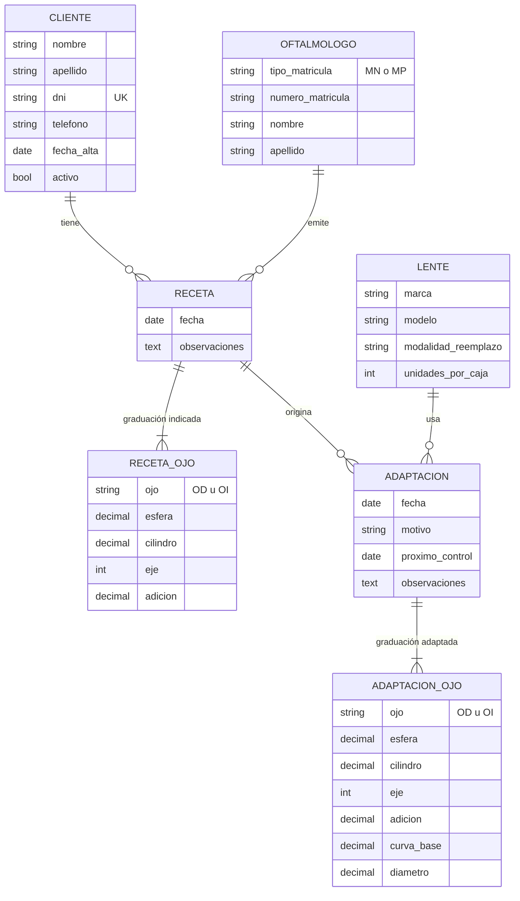

# Sistema de Gestión Óptica · Contactología

Sistema web para registrar y consultar las fichas de clientes del área de contactología de una óptica. Reemplaza las fichas en papel por una base de datos con historial completo: qué recetó el oftalmólogo, qué adaptó el contactólogo y cómo fue cambiando cada adaptación en el tiempo.

> **Estado:** en desarrollo · Etapa 0, relevamiento. Ver [Estado del proyecto](#estado-del-proyecto).

---

## El problema

Hoy cada cliente tiene una ficha en papel con sus datos, la graduación de la receta, la graduación adaptada, la marca de lentes y lo que pagó. Eso trae tres problemas concretos:

- **Los cambios se pierden.** Cuando cambia la graduación o la marca, la ficha se tacha o se reescribe, y el historial queda ilegible o desaparece.
- **No hay forma de buscar.** Encontrar una ficha depende de la memoria de quien atiende o de revisar el fichero a mano.
- **No hay información agregada.** Preguntas simples, como qué oftalmólogos derivan más clientes o a quién le toca control este mes, no tienen respuesta sin contar ficha por ficha.

## Qué hace el sistema

- **Clientes:** alta, edición, baja lógica y búsqueda por apellido, nombre o DNI.
- **Oftalmólogos por matrícula:** al cargar una receta se busca al oftalmólogo por su matrícula. Si ya existe, completa nombre y apellido; si no, se da de alta en la misma pantalla. Nunca se carga dos veces el mismo profesional.
- **Graduación indicada y adaptada:** se guardan por separado y por ojo. La indicada es la de la receta del oftalmólogo; la adaptada es la que define el contactólogo, con curva base, diámetro y lente.
- **Actualizaciones con historial:** cada cambio de graduación, de marca o de parámetros es un registro nuevo con fecha y motivo. Nada se sobrescribe y la ficha muestra la evolución completa del cliente.
- **Resumen de inicio:** clientes activos, controles por vencer y oftalmólogos que más derivan.

## Reglas de negocio

1. **La graduación indicada y la adaptada son datos distintos.** Una nunca reemplaza a la otra.
2. **Un oftalmólogo se identifica por tipo y número de matrícula** (MN o MP). La combinación es única en la base.
3. **Las adaptaciones no se editan, se actualizan.** Cada actualización crea un registro nuevo y la vigente es la más reciente.
4. **Los clientes no se borran.** La baja es lógica para conservar el historial.

## Modelo de datos



Las ventas (cajas, total, seña y pagos) tienen sus modelos definidos, pero sus pantallas llegan en una etapa posterior.

## Stack

| Capa | Tecnología |
|---|---|
| Lenguaje | Python 3.12+ |
| Framework | Django 6 |
| Base de datos | PostgreSQL |
| Interfaz | Django Templates, Bootstrap 5, django-crispy-forms |
| Configuración | python-dotenv |
| Control de versiones | Git y GitHub |

## Decisiones técnicas

| Decisión | Por qué |
|---|---|
| Django en lugar de Flask | El admin, las migraciones y la autenticación vienen incluidos. Permite concentrar el tiempo en el dominio y no en la infraestructura. |
| PostgreSQL desde el inicio | Es la base del despliegue final. Arrancar ahí evita una migración posterior. |
| Graduación en una tabla por ojo | Normaliza los datos: cada ojo es una fila y no columnas duplicadas `od_` / `oi_`. Facilita consultas y comparaciones. |
| Modelo abstracto `GraduacionOjo` | La graduación indicada y la adaptada comparten campos sin repetir código ni mezclar tablas. |
| Matrícula única por tipo y número | El mismo número puede existir como matrícula nacional y provincial. La restricción vive en la base, no solo en el formulario. |
| Actualizaciones como registros nuevos | El historial clínico no se pierde y se puede auditar qué cambió y cuándo. |
| `DecimalField` para graduaciones | Los valores van en pasos de 0,25 y no admiten errores de redondeo de `float`. |
| Una app de Django por dominio | `clientes`, `profesionales`, `contactologia`, `catalogo` y `ventas` crecen de forma independiente. |

## Cómo levantarlo en local

Requisitos: Python 3.12 o superior, PostgreSQL y Git.

```bash
git clone https://github.com/marcosnicolasdev-code/<nombre-del-repo>.git
cd <nombre-del-repo>

python -m venv venv
source venv/Scripts/activate      # Git Bash en Windows
# venv\Scripts\activate           # CMD en Windows

pip install -r requirements.txt

cp .env.example .env              # completar con los datos de tu PostgreSQL
python manage.py migrate
python manage.py createsuperuser
python manage.py runserver
```

El sistema queda disponible en `http://localhost:8000` y el panel de administración en `http://localhost:8000/admin`.

### Variables de entorno

| Variable | Descripción |
|---|---|
| `SECRET_KEY` | Clave secreta de Django |
| `DEBUG` | `True` en desarrollo |
| `DB_NAME` | Nombre de la base |
| `DB_USER` | Usuario de PostgreSQL |
| `DB_PASSWORD` | Contraseña de PostgreSQL |
| `DB_HOST` | Host, normalmente `localhost` |
| `DB_PORT` | Puerto, normalmente `5432` |

## Estado del proyecto

| Etapa | Contenido | Estado |
|---|---|---|
| 0 · Relevamiento | Fichas reales, alcance y diagrama entidad-relación | En curso |
| 1 · Fundamentos | Proyecto, modelos, migraciones y admin | Pendiente |
| 2 · Clientes | Alta, edición, búsqueda y ficha | Pendiente |
| 3 · Oftalmólogos y recetas | Búsqueda por matrícula y graduación indicada | Pendiente |
| 4 · Adaptaciones | Graduación adaptada, actualizaciones e historial | Pendiente |
| 5 · Pulido | Validaciones, inicio, datos de demostración y v1.0 | Pendiente |
| 6 · Demo online | Despliegue con datos ficticios | Pendiente |

**Próximas versiones:** ventas con seña y pagos parciales, recordatorio de reposición de lentes, login por usuario y tests automatizados, y un módulo de óptica tradicional (armazones y cristales).

## Privacidad

Las graduaciones son datos de salud. Este repositorio y cualquier demo usan **exclusivamente datos ficticios**, generados para pruebas. La base de datos y el archivo `.env` nunca se suben al repositorio.

## Autor

**Marcos Nicolás Gómez Ramunno** · Técnico Superior en Desarrollo de Software (en curso) · Rosario, Argentina

[LinkedIn](https://linkedin.com/in/marcosnicolas-dev) · [GitHub](https://github.com/marcosnicolasdev-code)
